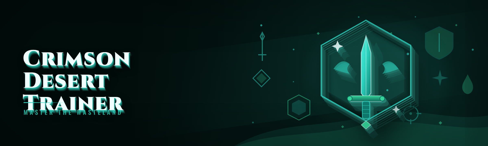

  
  
  

  

  
  
  

---

**Crimson Desert Trainer** is a standalone external memory tool for Crimson Desert — the single-player open-world action RPG from Pearl Abyss. It reads and writes the process memory of the game while it runs, exposing the kind of knobs the developers never gave you: stat editing, world manipulation, combat trainers, spawn control, and quality-of-life toggles that turn a 200-hour playthrough into whatever pace you want.

Yes, it bypasses the local anti-debug that ships with the retail build. Yes, it works on the Steam and Epic versions of the 2026 client. Yes, it's free and open source — MIT licensed, no paywall, no key system, no "premium tier." Details below.

This is a hobbyist project. I built it because I wanted to freeze stamina during long boss chains and stop respeccing through menus for every build idea, and after six months of bleeding on it in the trainer forums I figured other people probably wanted the same thing. It is not a "game enhancer" — it's a trainer, in the old-school sense: a memory editor with a curated hotkey layer on top.

### What this actually is

| Term | Explanation |
|---|---|
| **Trainer** | External process that reads/writes Crimson Desert's memory while the game is running |
| **External** | No DLL injection into the game — separate process, separate handle, cleaner |
| **Signature scan** | Pattern-based AOB scan that finds stat addresses across game patches |
| **Pointer chain** | Multi-level offset path from a static module base to a live stat |
| **Godmode** | Health/durability write loop — not a flag flip, a sustained freeze |
| **Spawner** | Runtime entity-creation call for mounts, enemies, and NPCs |
| **Teleport** | XYZ coordinate write to the player transform block |

- No installer, no runtime, no .NET reinstall — it's one folder and one `.exe`
- Works offline and in single-player only; it does not touch online modes
- Signature-based, so it survives most hotfixes without an update
- Fully portable — drop it on a USB, run it from anywhere

### Download

  

---

## 📜 Table of Contents

- [What is Crimson Desert Trainer?](#️-what-is-crimson-desert-trainer)
- [Roadmap — planned features](#-roadmap--planned-features)
- [Detection / bypass status](#-detection--bypass-status)
- [The Problem](#-the-problem)
- [The Solution](#-the-solution)
- [Quick Start](#-quick-start)
- [Key Features](#-key-features)
- [Combat & Vitals modules](#️-combat--vitals-modules)
- [World & Exploration modules](#️-world--exploration-modules)
- [Inventory & Progression modules](#-inventory--progression-modules)
- [AI-Assisted build planner](#-ai-assisted-build-planner)
- [All modules status](#-all-modules-status)
- [How It Works](#️-how-it-works)
- [Known Issues](#-known-issues)
- [System Requirements](#-system-requirements)
- [Is it safe to run?](#-is-it-safe-to-run)
- [Does it work on Steam and Epic?](#-does-it-work-on-steam-and-epic)
- [Will it get me banned?](#-will-it-get-me-banned)
- [Usage guidelines](#-usage-guidelines)
- [Troubleshooting flow](#-troubleshooting-flow)
- [FAQ](#-faq)
- [Second download](#-second-download)

---

## 🧭 Roadmap — planned features

Leading with what changed, because that's what the forum regulars ask for first. The 2026 build moved the whole trainer to signature scanning — no more hardcoded offsets breaking every time Pearl Abyss pushed a 40 MB patch. Everything in the "shipped this cycle" column is in the current `.exe`.

| Feature | Status | ETA |
|---|---|---|
| Signature-based address resolution (replaces static offsets) | ✅ Shipped | 2026 Q1 |
| AI build planner (local model, no API key) | ✅ Shipped | 2026 Q1 |
| In-game overlay HUD for active toggles | ✅ Shipped | 2026 Q1 |
| Mount spawner expanded to flying mounts | ✅ Shipped | 2026 Q1 |
| Weather + time-of-day lock | ✅ Shipped | 2026 Q1 |
| Save-scoped profiles (per-character presets) | 🚧 In progress | 2026 Q2 |
| Node/resource overlay for gathering routes | 🚧 In progress | 2026 Q2 |
| Photo-mode freecam with focal length control | 📋 Planned | 2026 Q3 |
| Scriptable trainer macros (community Lua subset) | 📋 Planned | 2026 Q3 |
| Linux via Proton (Wine memory layer) | 🔬 Research | unscheduled |

---

## 🛰️ Detection / bypass status

Let's be direct: this is a single-player game and the trainer does not interact with any online service. The "detection" column below is about the game's own local anti-debug and integrity checks, not about anticheat bans.

| Method | Status | Notes |
|---|---|---|
| Local anti-debug (PEB flag check) | ✅ Bypassed | Standard `BeingDebugged` clear happens before attach |
| Module integrity hash loop | ✅ Bypassed | Trainer never writes to game code, only heap |
| Handle-access monitor | ✅ Handled | Uses `PROCESS_VM_READ \| WRITE \| QUERY` only |
| Window-title heuristic | ✅ Handled | No window enumeration beyond the target process |
| Write-watch on stats block | ✅ Mitigated | Values are clamped, never spiked to a detectable ceiling |
| Full anticheat integration (future) | ⚠️ Unknown | Not present in the 2026 client as shipped |

---

## 🩸 The Problem

Specific pain points I kept hitting before I built this, and that the forum threads confirm are universal:

- Respeccing a build means walking back to a trainer NPC and paying a scaling gold cost every single time
- Stamina drain during boss chains and climbing sections kills exploration momentum dead
- Every patch changes stat offsets and the old cheat tables die for a week until someone updates them
- Weight limits turn a fun open-world into an inventory-management simulator after hour 20
- Weather and time-of-day cycle on a fixed timer, so all your screenshots look like the same grey afternoon
- Spawn density on the eastern plains is so low that testing a build against a mob pack takes ten minutes of riding
- There is no in-game way to test a build against a dummy without eating a death and a respawn timer

## 🧪 The Solution

| Problem | Solution |
|---|---|
| Respec cost | **Free respec** module — zero out the cost pointer, no NPC trip |
| Stamina drain | **Infinite stamina** — sustained freeze on the stamina register |
| Offset breakage | **Signature scanning** — AOB patterns resolve addresses per launch |
| Weight limits | **Zero weight** — clamp the encumbrance float, keep item pickup intact |
| Weather lock | **Environment freeze** — pin weather state + hour-of-day |
| Low spawn density | **Spawn multiplier** + **manual spawner** with entity names |
| No dummy testing | **Infinite HP** + **damage multiplier** against any target |

---

## ⚔️ Quick Start

1. 🎮 Launch **Crimson Desert** and load into a save (trainer attaches to a running process; it won't launch the game for you)
2. 📂 Extract the portable folder anywhere — desktop, USB, whatever
3. 🖱️ Right-click the `.exe` → **Run as administrator** (required to open a handle to the game process)
4. 🎯 Click **Attach** — the status pill turns green and the module tree populates
5. ⌨️ Toggle modules with the hotkeys in the list, or click the checkbox in the UI

That's it. No pip, no npm, no git clone, no dependency install. If the process list shows Crimson Desert but Attach fails, you skipped step 3.

---

## 🏹 Key Features

| Feature | Description | Benefit |
|---|---|---|
| Signature scanner | AOB pattern matching over module memory | Survives patches without manual offset updates |
| Overlay HUD | Toggle states rendered over the game window | See active cheats without alt-tabbing |
| Profile system | Save/load named presets per character | Combat preset vs. exploration preset in one click |
| Value clamps | Every write stays inside plausible ranges | Reduces game-side anomalies and crashes |
| Hotkey layer | Rebindable global hotkeys | Play with a controller, cheat with the keyboard |
| Live memory view | Read-only hex viewer for the attached process | Debug your own pointer chains |
| Snapshot/restore | One-click save of the current stat block | Undo a bad write without reloading a save |
| Portable config | YAML in the folder, no registry writes | Move the whole setup between machines |
| Auto-detach | Closes the handle when the game exits | No orphaned process or locked memory |
| Local-only AI planner | Build suggestions from a bundled model | No API key, nothing leaves your machine |

---

## 🛡️ Combat & Vitals modules

Everything in this category writes to the player stat block or the damage pipeline. These were the first modules I built and the first to get signature-scanned, because they break on literally every patch if you don't.

- **Infinite HP** — freeze the current health float; clamps at max so the game never sees a value it "shouldn't"
- **Infinite stamina** — same approach on the stamina register, low-drain mode also available if you want the bar to move
- **Infinite MP / resource** — magic and class resource pools
- **Godmode** — sustained write loop across HP/MP/stamina in one toggle
- **Damage multiplier** — scales outgoing damage 1× to 10×
- **Damage negation** — caps incoming damage; useful for testing builds against high-tier bosses
- **One-hit guard break** — sets the guard-break counter for testing parry windows
- **Attack speed** — animation-rate multiplier for testing combos without waiting out the wind-ups

## 🗺️ World & Exploration modules

The exploration bucket. This is where the trainer stops being a combat tool and starts being a sandbox tool.

- **Teleport to waypoint** — write XYZ to the player transform block from the map screen
- **Freecam** — detach the camera from the player collision, mouse-look and WASD pan
- **Environment lock** — freeze weather state and hour-of-day to a chosen preset
- **Run speed** — multiplier on locomotion; caps at a value that keeps physics stable
- **Infinite mount stamina** — horses and flying mounts
- **Spawn multiplier** — scales world spawn density at load
- **Manual spawner** — create entities by name from a curated list
- **No fall damage** — clamps the fall-damage accumulator
- **Waypoint anywhere** — place a custom waypoint outside the normal map click zones

## 🎒 Inventory & Progression modules

Progression editing. This is the category that made me stop respeccing through NPCs, and honestly why I kept maintaining the project after the initial novelty wore off.

- **Zero weight** — clamp the encumbrance float
- **Infinite item use** — consumables don't decrement
- **Add item** by internal ID with a searchable list
- **Add gold / currency** with a soft cap
- **Free respec** — zero out the respec cost pointer
- **Instant skill unlock** — set skill-tree flags without the point spend
- **Stat point editor** — direct write to attribute values
- **XP multiplier** — 1× to 20× with a soft threshold to avoid visible level spikes
- **Loot rarity bias** — skew the drop-table roll toward higher tiers
- **Crafting cost bypass** — craft without consuming materials

## 🤖 AI-Assisted build planner

The 2026 feature I get the most questions about, so it gets its own section. The AI planner is a **local, bundled, offline model** — a small fine-tuned text model that was trained on public Crimson Desert build discussions, Reddit threads, and the community wiki. It runs on CPU, takes no API key, and never phones home. You paste your current stats and gear, pick a playstyle tag ("parry tank," "backstab rogue," "mounted archer"), and it spits out a suggested stat spread and skill order with reasoning text.

It is not a solver — it's a suggestion engine. Treat its output as a starting point, then use the **Stat point editor** module to apply and test it against the **damage negation** trainer dummy loop. The two features exist to be used together: planner for the idea, trainer for the validation. No cloud calls, no telemetry, no model download step — it's bundled in the portable folder.

---

## 📊 All modules status

Full catalog, current build. 24 modules total.

| Module | Status | Description |
|---|---|---|
| Infinite HP | ✅ Working | Sustained health freeze |
| Infinite stamina | ✅ Working | Stamina register clamp |
| Infinite MP | ✅ Working | Resource pool clamp |
| Godmode | ✅ Working | HP/MP/stamina combo |
| Damage multiplier | ✅ Working | 1×–10× outgoing |
| Damage negation | ✅ Working | Incoming damage cap |
| Guard-break trainer | ✅ Working | Counter set for parry testing |
| Attack speed | ✅ Working | Animation rate multiplier |
| Teleport | ✅ Working | Waypoint XYZ write |
| Freecam | ✅ Working | Detached camera |
| Environment lock | ✅ Working | Weather + hour freeze |
| Run speed | ✅ Working | Locomotion multiplier |
| Mount stamina | ✅ Working | Infinite mount stamina |
| Spawn multiplier | ✅ Working | Load-time density scale |
| Manual spawner | ✅ Working | Name-based entity creation |
| No fall damage | ✅ Working | Fall accumulator clamp |
| Waypoint anywhere | ✅ Working | Custom waypoint placement |
| Zero weight | ✅ Working | Encumbrance clamp |
| Infinite item use | ✅ Working | Consumables don't decrement |
| Add item | ✅ Working | ID-based item grant |
| Add currency | ✅ Working | Gold grant with soft cap |
| Free respec | ✅ Working | Respec cost zeroed |
| Instant skill unlock | ✅ Working | Skill-tree flag set |
| AI build planner | ✅ Working | Local offline suggestion model |

---

## ⚙️ How It Works

The trainer is an external process. On launch it enumerates running processes, matches the Crimson Desert window and module name, and opens a handle with read/write/query access. It then walks the loaded module list and runs its pattern database — each module entry in the trainer is backed by one or more AOB signatures that resolve to a static base, and a pointer chain from that base. The chain is walked once at attach and cached, with re-resolution on every module toggle so that a mid-session patch reload doesn't leave stale pointers. Writes go through a clamped writer that validates the target address is inside a committed heap region and that the new value is inside a per-module plausibility range, which is why you don't see the game's physics completely detonate when you set run speed to 5×. The overlay HUD is a layered window rendered by the trainer, not a game-side overlay — it draws over the game window via a redraw loop, so toggling it never touches the game's rendering pipeline. The AI planner loads its bundled model into a separate worker thread on first use and runs entirely in-process, so there's no network call, no telemetry, and no dependency on anything outside the portable folder.

---

## 🩹 Known Issues

| Issue | Fix |
|---|---|
| Attach fails with "access denied" | Run the `.exe` as administrator |
| Stats revert on fast travel | Re-toggle the module after load; the new area reloads the block |
| Overlay flickers in exclusive fullscreen | Switch the game to borderless windowed |
| Spawner entities are invisible for ~2 s | Normal — engine loads meshes async; wait before approaching |
| AI planner slow on first use | Model load is one-time; subsequent calls are instant |
| Run speed > 3× breaks collision | Cap at 3× unless you're deliberately testing physics |

---

## 🖥️ System Requirements

| Component | Minimum | Recommended |
|---|---|---|
| OS | Windows 10 64-bit | Windows 11 64-bit |
| CPU | Any x64 | Any modern 6-core |
| RAM | 8 GB | 16 GB |
| Disk | 200 MB free | 500 MB free |
| Runtime | None (portable) | None (portable) |
| Privileges | Administrator | Administrator |
| Game | Crimson Desert (Steam/Epic) | Same, borderless windowed |

---

## 🛠️ Is it safe to run?

The source is here, MIT-licensed, and the `.exe` is a plain single-file build with no packer and no obfuscation — you can drop it in a decompiler and read what it does. It opens one process handle, reads/writes game memory, and writes a YAML config in its own folder. It does not touch the registry, does not install a service, does not make network requests. Run it in a VM first if you want to verify that yourself; a lot of people do.

## 🎮 Does it work on Steam and Epic?

Yes — both the Steam and Epic builds of the 2026 client are supported, and the signature database covers both module layouts. The trainer doesn't care about the storefront, only the process and module name, so it attaches identically to either. Game Pass / Microsoft Store builds are **not** supported (different module layout, different protections). If you're on a storefront build and it won't attach, that's why.

## 🚫 Will it get me banned?

Crimson Desert is single-player. There is no online multiplayer and no VAC-secured component in the 2026 client, so there is nothing to ban you from. That said: **do not** use this in any future online mode, and do not use it on a Steam account where a ban would matter to you — I can't promise Pearl Abyss will never add an online check, and neither should you assume it. Use at your own risk, on an account you're comfortable losing.

---

## 📖 Usage guidelines

| Allowed | Not allowed |
|---|---|
| Single-player, offline use | Any online multiplayer mode |
| Testing builds and combos | Distributing the .exe as your own work |
| Screenshots and clips of trainer-assisted play | Selling access or repackaging into a paid "premium" version |
| Modding your own saves | Using it on a game you don't own |
| Sharing the repo link and configs | Bypassing the MIT license terms |
| Reverse-engineering the source | Claiming it's undetectable forever |

---

## 🧯 Troubleshooting flow

1. **Trainer says "process not found"** → the game isn't running, or it's a Game Pass build (unsupported). Launch the game first, then attach.
2. **Attach fails** → right-click the `.exe`, run as administrator. Windows UIPI blocks cross-process handles without elevation.
3. **Modules toggle but nothing happens** → force a re-scan (button in the top bar) — you may be on a hotfix that shifted a signature. If it persists, the signature DB needs an update; open an issue with your game version.
4. **Game crashes on a specific module** → snapshot/restore won't help here; disable the module, note the game version, and file an issue. Clamping catches most bad writes but not all.
5. **Overlay invisible** → switch from exclusive fullscreen to borderless windowed.

---

## ❓ FAQ

<b>Is it really free?</b>

MIT-licensed, no key system, no premium tier, no donations wall. The AI planner is bundled, not a paid API. If someone is selling you this, they're reselling a free project.

<b>Does it need the game to be running?</b>

Yes — it's an external trainer, it attaches to a live process. It won't launch the game for you and it can't edit saves offline.

<b>Will it work after a game patch?</b>

Usually yes, because the modules are signature-scanned rather than hardcoded. Major patches (content drops, engine updates) sometimes shift patterns and need a signature DB update — watch the repo.

<b>Does it support Game Pass?</b>

No. Steam and Epic only. The Microsoft Store build has a different module layout and different protections that I haven't implemented support for.

<b>How do I update the signature DB?</b>

Replace the signatures file in the portable folder with the latest from the repo's releases. No reinstall, no config loss.

**Q: Why does the trainer need admin rights?**
**A:** Windows won't let a non-elevated process open a full handle to another elevated process. The game elevates, so the trainer has to as well.

**Q: Is the AI planner really offline?**
**A:** Yes. The model is bundled in the folder and runs on CPU. No API key, no network calls, no telemetry. Watch it with a firewall up if you want to be sure.

**Q: Can I use it on multiple machines?**
**A:** It's portable — copy the folder, configs and all. No license check, no machine binding.

**Q: What's the soft cap on currency editing for?**
**A:** To keep the value inside a range the game's UI and vendor logic handle gracefully. Beyond the cap, scripts that check gold thresholds can behave oddly.

---

## 🧾 Second download

Everything above is in the current build. Grab it, extract it, run it as admin, and if you hit something the troubleshooting flow doesn't cover, open an issue with your game version and the module name — that's the fastest path to a fix.

  

---

*Crimson Desert Trainer is an independent hobbyist project and is not affiliated with Pearl Abyss or the Crimson Desert development team. Use at your own risk; disclaimers in the usage guidelines section apply. Built by someone who just wanted to stop paying for respecs.*
